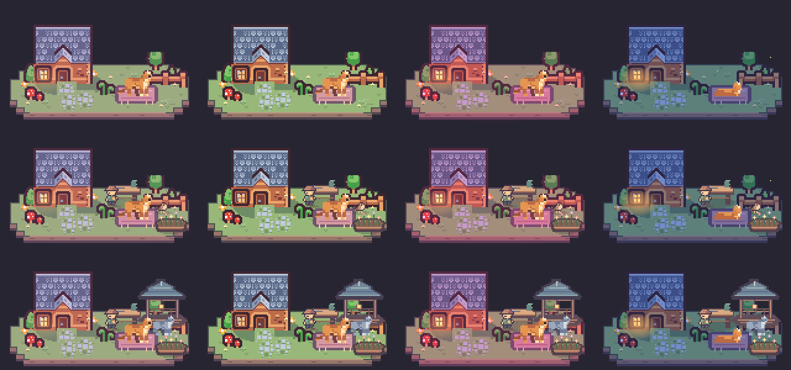

# 猫咪小屋

猫咪小屋是 Windows 桌面上的像素庭院。橘猫会进食、走动和休息，管理员按时来照看猫咪和修建院子，麻雀、灰猫和黑猫偶尔来访。小屋随电脑时间亮灯，庭院天气在本地模拟。



## 使用

- 双击 `猫咪小屋.exe`，按 **Win+D** 回到桌面。程序也可以从任务栏通知区域打开菜单。
- 单击小屋喂猫咪零食。拖动小屋可以换位置，拖动右下角或用右键菜单调整大小。
- 右键打开「院子互动」，可以摆上或收起水碗、给访客留点心、邀请客人、呼唤管理员、轻敲窗户或控制门廊灯。
- 打开「观察手记」查看猫咪、管理员、天气、访客和建设进度。右键菜单也可以切换天气和季节，或显示、隐藏及退出小屋。
- 管理员在本地时间 08:10–08:18 和 17:05–17:15 逐步建花圃、工作台和凉亭。关掉小屋以后，经过的施工时段会在下次打开时补算。

程序在桌面前台绘制，切到应用窗口时暂停画面刷新。设置和进度保存在可执行文件旁的 `cat-home-settings.txt`，位置保存在 `cat-home-position.txt`。移动小屋时可把这两个文件一并带走。

## 设计表

行为表包含 112 项自动行为和 12 项手动交互，可以用浏览器离线打开，按角色筛选或搜索。表格数据在 `design/`，其中 `animals.tsv` 记录猫咪和管理员，`visitors-yard.tsv` 记录来客和庭院，`interaction.tsv` 记录手动交互。

在源码目录运行以下命令可以重建表格。生成脚本只依赖 Python 标准库。

```powershell
python design/export_table.py "小世界行为表.html"
```

## 编译

在 Windows 上安装当前稳定版 Rust 和对应的 Windows 链接工具。在源码目录执行以下命令。

```powershell
cargo test --locked
cargo build --locked --release
```

默认目标的程序在 `target/release/cat-home.exe`。运行时所需的像素图已经内嵌。编译随包提供的图不需要 Python。

修改原图或绘制逻辑后，运行下面的命令重建图集，再重新编译。原始猫图集和庭院素材在 `sources/`。

```powershell
python -m pip install Pillow
python bake_world.py
```

## 许可

代码采用 MIT 许可。像素素材和图集的许可与作者见 [素材和代码来源](CREDITS.md)，MIT 正文与上游版权声明见 [LICENSE](LICENSE)。
