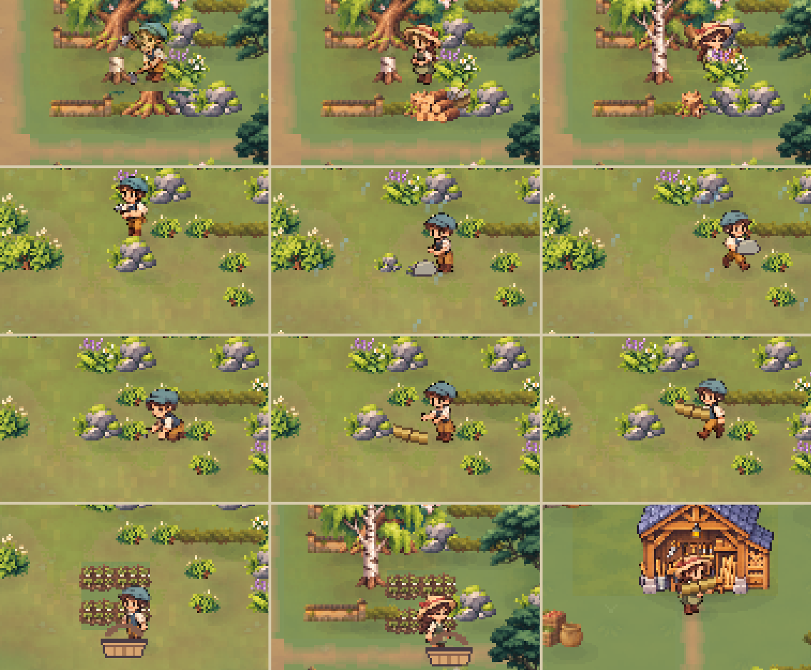
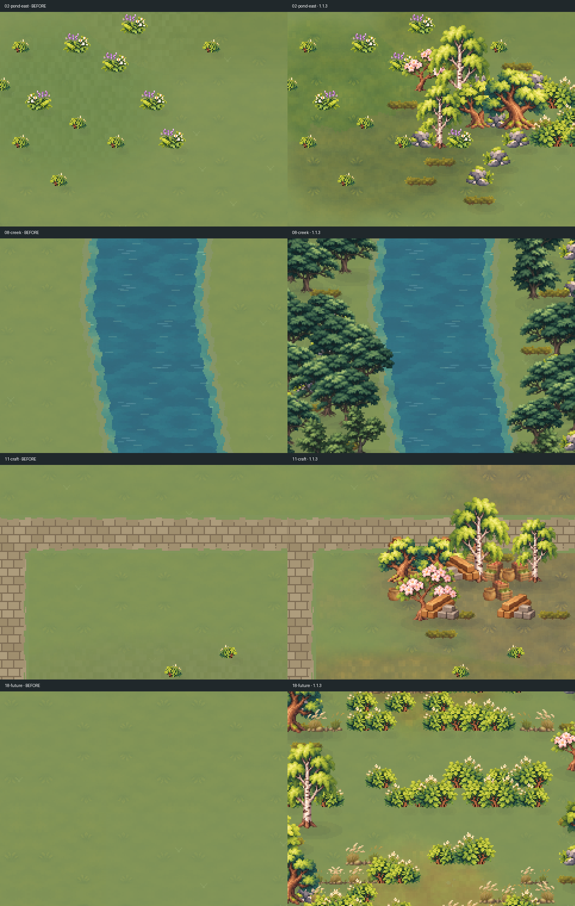

# 猫咪小屋 · 柳溪村

Windows 桌面上的像素生活小世界。小禾、阿榆和橘猫住在村庄西北的小院，日常种植、收获、做饭、照料猫咪，出门赶集、劳动和建设。程序使用原生 Windows 窗口，不依赖浏览器或游戏引擎。

1.1.9 新增 **126 个有实际结果的条件变体**，累计 **100 个基础行为和 294 个条件变体**。两人错身、落木避让、搬运归仓、空餐柜后改道做饭、雨停续走、池边钓鱼和晨间鸟类互动都会按现场情况留下短期记录。 [本版变体清单](docs/LEGACY_VARIANTS_1_1_9.md) · [逐条审查表](docs/current-behavior-audit.tsv)

1.1.8 新增 **88 个有实际效果的条件变体**，累计 **100 个基础行为 + 168 个条件变体**。试井、巡检、排涝、回屋和其他场景会保留可查看的现场记录。新画作在特定条件下会保留 14 或 28 个世界日。 [本版变体清单](docs/LEGACY_VARIANTS_1_1_8.md) · [完整审查表](docs/current-behavior-audit.tsv)

1.1.7 新增 **54 个基础行为和 39 个精确场景，共 93 个旧编号**。累计接通 **100 个基础行为 + 80 个条件变体 = 180 个**。新增晾晒并归还猫垫、穿围裙做饭、雨桶接水修补、土层检查、同包种子换封、燕子筑巢与春归、松鼠埋果取回/萌芽等真实流程。


上图取自实际回放的不同时间与局部机位。180 个编号复用动作和已有流程，**不是 180 套独立动画**。旧目录另外 4,820 个尚未接入，逐条说明原因和依赖；不把纸面数量当作已完成内容。详见 [本版流程与 54 项清单](docs/LEGACY_BEHAVIORS_1_1_7.md)、[完整 5,000 行现版审查](docs/current-behavior-audit.tsv)、[精确统计](docs/current-behavior-counts.json) 和 [验证记录](docs/VALIDATION.md)。

右键“观察手记”区分已接入和本档实际见到的数量。“轻敲窗户”已接真实附近橘子的转耳与回望。有限物件、短期痕迹和固定记录槽避免每天追加永久历史；旧存档升级保留原件和进度。

保留 [1.1.6 的分段浇水、堆肥、蜂访果树和动物作息](docs/LEGACY_BEHAVIORS_1_1_6.md)，以及 [1.1.5 的清理、写生、邮差和收摊](docs/LEGACY_BEHAVIORS_1_1_5.md)。

保留 1.1.4 的真实资源生活：2,635 处树木、灌木、石头、倒木、草和芦苇可按实际需求采集。人物取工具、到场做工，留下倒木、树桩、碎石或草束，再搬回仓库；草纤维需在工坊搓成绳。木、石、绳供实际施工消耗，库满不会重复发材料。



两块新增田先清树石，再翻整、耗种、浇水和收获。池东新地可建住宅；已有共同住宅的家庭会建农储屋，保留原住址，并在新仓实际处理、卸入附近田的收成。新屋仍经历清场、基础、框架、屋顶、内装和启用六阶段。清地不会自动允许任意位置建房，河岸、道路和公共工作位仍受保护。


上面两张图来自正常自主回放的实际存档。采集按需求、每日有限工时进行；2,635 处普通资源之外，732 处临时地被由真实整地翻入土壤，不额外奖励草料；428 处护岸自然物、家具、设施和花景保留原用途。规则、边界与实测见 [地貌资源](docs/WORKING_LANDSCAPE.md)、[新土地用途](docs/WORKING_LANDSCAPE_ZONING.md) 和 [验证记录](docs/VALIDATION.md)。

保留 1.1.3 的集中林带、河岸植被、果园边林、院落和岩坡：全图 3,795 处景物按视野查询与绘制。已清除的景物保存固定容量状态，不因每天运行追加记录。

新障碍参与实际寻路；旧档先保留已经迈出的一步，再安全启用新地图。树冠在遮住主角时局部让出轮廓，大窗口也不再因景物数量上限漏画。保留 1.1.2 的平滑跟随和生活流程修复。地图设计、迁移与实际验证见 [地图文档](docs/MAP_DENSITY.md)、[存档迁移](docs/MAP_DENSITY_MIGRATION.md) 和 [验证记录](docs/VALIDATION.md)。



上图来自游戏实际绘制。道路、门前、田面与公共活动区仍保留必要空间。旧版 5,000 条变体尚未全部接入正式村庄，也没有逐条专属动画；范围见 [共享规则接入表](docs/SHARED_RULES_PORT.md)。


上图是 1.1.0 较远倍率的历史测试取景，由存档跨过第 365 真实日后继续自然运行取得；六摊、人物和货品均读取当时实际状态。新档从较简朴的村庄开始。下面是旧倍率的窄窗边框示例，当前版本保留同样的细边框。


## 启动与操作

下载 [发布页](https://github.com/forguse/cat-home/releases/latest) 里的 `cat-home-windows-x64.exe`，放进可写的普通文件夹后双击。运行所需图片、地图和核心内容均已内嵌；Rust、Python 只用于开发。

- 左键拖动窗口；按住 Shift 拖动则移动镜头。
- 拖动右下角改变视野宽高。像素比例固定，缩小视野不会删除世界。
- 右键 → 镜头，可选择自动观察生活、跟随角色、手动取景或回到庭院。只要有人醒着，镜头保留至少一位主角；手动取景也受此约束。两人都睡着时可停在住所。
- 右键 → 观察手记，查看当前活动、资源和进度。
- 右键 → 插件 → 安装插件，可以安装 `.catpack` 内容包。篮球示例包位于 `content-packs/basketball/`；新档需有可用公共活动场地，安装不会凭空跳过建设。
- 右键小屋或通知区域图标，可显示、隐藏、退出及设置登录 Windows 时启动。

程序运行期间持续更新。只绘制窗口视野内及边缘相交的物体，画外仍模拟生活。离线期间按同一时间规则补算；白天 48 倍、夜间 96 倍。程序会分批处理较长离线时间，手记显示追平状态。

## 真实几个月里的成长

日常昼夜加速，小镇扩建使用真实日历。关闭电脑的时间也计入村龄；累计陪伴时长单独计算。工程到日期只是允许开工，仍须真实取材、运料、施工和验收，不会凭日期自动出现成品。

| 已过真实日 | 最早可以展开的变化 |
| --- | --- |
| 0–6 | 六块家用田、基本住屋与生产场所；少量邻居和可收起的周集。持续种植、做饭、捕鱼、互助。 |
| 7–29 | 扩田、村路和货运准备、家庭工坊改进；工程分批开放。 |
| 30–89 | 固定小集筹备、试办、避雨与收摊，之后建市场街、后排商铺、装卸点、路灯和排水。 |
| 90–179 | 第二住宅区分段施工、短住试用，完成备粮备水与入住流程后再成为邻居。 |
| 180–364 | 合作生产、仓储和公共设施扩展，更多轮班、供货、修补及来往。 |
| 365–729 | 成熟街区维持供给与公共生活；花园工程仍逐步完成，熟客回访与周年小聚。 |
| 730 起 | 旧物维护、修复及纪念，继续季节生活。建筑、人口和记录均有上限。 |

这是最早许可时间，不是无条件完成日期。发展规范见 [真实日历城镇](docs/REAL_TIME_TOWN.md)，已验证范围见 [验证记录](docs/VALIDATION.md)。旧档已取得的建筑、住户和合法预约保留，不会为新节奏拆掉现有小镇。

## 地图与生活

地图为 192×128 格，16×16 格分块。住家、农田、果园、林地、河道、桥、市集与后期街区各有位置。四个周集摊位围绕同一条街道营业，林木按林带和林缘集中分布。树木、围栏、建筑、水面及施工场地参与通行判定，人物从门口和实际道路行走。

新生活从周五清晨开始，具备基本粮水和六块初始菜地。周六集市由摊主实际备货、到场营业；主角带货出门、排队交换、回家入库。收获、种子、食物和材料有有限库存，失败交易不会凭空增加物品。固定住户有独立住所、职业、作息和外出目的，访客数量受场所容量约束。

核心状态使用有限地块、固定角色、有限库存和容量受限的事件记录。长期模拟测试与实际 Windows 进程的性能测量是不同验收项；源码不承诺所有电脑上内存恒定低于 10 MB，也不把整个设计文档的条目数等同于已验证的独立动画。

## 存档与兼容

新版本在 EXE 同目录的 `home-data-v2/world-v4.json` 保存村庄。目录名称保留兼容；文件内容采用 v4。旧庭院的 `world-v2.json` / `world-v3.json` 读取后迁移到新文件，原件保留，迁移来源记录 SHA3-256 摘要。

启动参数 `--recover-v3` 打开旧庭院恢复模式，进度另存为 `world-compat-v3.json`。`--legacy` 是更早的桌宠版本，两者不同。未知或损坏的存档会报错并保留文件，不会静默重开世界。退出时保存，平时定时保存，以单个临时文件原子替换。

完整搬迁时，请连同 `home-data-v2` 文件夹及窗口位置文件一起移动。更新时退出旧进程再替换 EXE。测试参数 `--isolated-preview` 使用独立预览环境，不迁移或写入用户生活档。

## 卸载

在菜单取消登录启动，选择退出，再手动删除 EXE 即可。保留 `home-data-v2` 可在下次继续；如需彻底移除，再手动删除自己的存档、插件和窗口位置文件。程序不需要后台服务。

## 开发

活动扩展指南见 [插件开发](docs/PLUGINS.md)，主线设计见 [72 章流程表](docs/chapters.tsv)，目录数量与动画限制见 [内容清点](docs/content-census.md)，实际测试范围和资源口径见 [验证记录](docs/VALIDATION.md)。

需要 Rust 2024 工具链，以及 Windows 链接与资源编译工具。GNU 工具链使用 `windres`（可通过 `WINDRES` 指定）；MSVC 使用 Windows SDK 的 `rc`。

```powershell
cargo test --locked
cargo build --locked --release
python tools/compile_map.py --check
python -m unittest discover -s tools -p test_compile_map.py
python -X utf8 tools/compile_legacy_bindings.py --check
python -X utf8 -m unittest discover -s tools -p test_compile_legacy_bindings.py
python -X utf8 tools/audit_cast_rules.py --check
```

生成的程序位于 `target/release/cat-home.exe`。构建直接读取已提交图集，通常无需 Python；修改地图或重烘焙图片时需要 Python，图集工具另需 Pillow。源码包会排除个人存档、编译目录、测试输出、日志、旧 EXE 和本机配置。

核心模块：

| 位置 | 职责 |
| --- | --- |
| `src/living_world.rs` 及其子模块 | 家庭状态、任务顺序、工具、库存、农业、建造 |
| `src/residents.rs` 及服务模块 | 居民、出行、商贸、活动触发、有限物件保管 |
| `src/map_data.rs`、`map_view.rs`、`map_nav.rs` | 编译地图、占位、分批寻路 |
| `src/living_view.rs`、`village_render.rs`、`village_camera.rs` | 图集绘制、可见范围、镜头 |
| `src/home_host.rs` | 正式程序使用的调度、迁移、存档与插件接入 |
| `src/plugins/`、`plugin_scene.rs` | 数据插件校验、资源上限、活动预约及执行 |
| `assets/maps/` | 唯一运行地图来源及活动规则表 |
| `tools/` | 地图编译、素材烘焙、示例插件构建与验证 |
| `examples/village_host_probe.rs` | 实际宿主整合、迁移、离线推进和存读验证 |

地图 JSON 改动后运行 `python tools/compile_map.py`，再提交生成的 `.tiles` 与 Rust 静态表。不要直接手改生成表。开发文档与逐条验收记录区分已完成机制、共用机制和待验收内容。

## 许可

代码采用 MIT；具体第三方素材来源及项目生成素材声明见 [CREDITS.md](CREDITS.md)。未使用商业游戏中的贴图、角色或地图。
