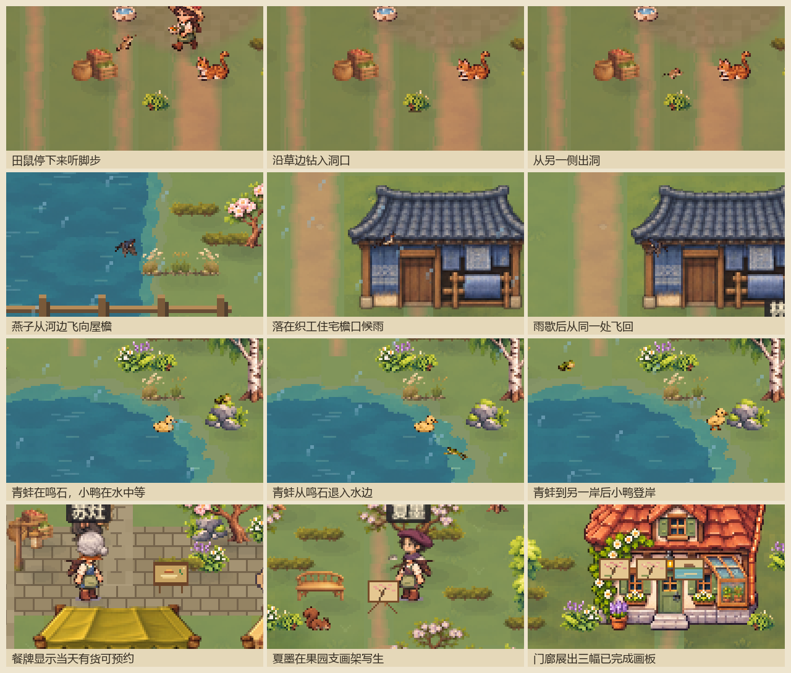

# 1.1.5：旧目录的真实生活接入

本版将旧 5,000 个编号中的 **24 项基础行为、41 个精确条件变体，共 65 个编号**接入默认柳溪村。其余 **4,935 个编号尚未接入**。这不是能实现数量的理论上限，也不是 65 套新动画。部分行为新建了有限工作流程，部分为既有真实流程补上旧 ID 和完成凭证；两类都必须实际发生，不能因目录存在就记为完成。

旧目录本来由 424 项基础和 4,576 项变体组成。现有村庄的 284 项互动/事件与本表存在流程重叠，不能相加得到独立内容数。全面原文、条件、适配缺口与登记状态见 [5,000 行审计](legacy-cast-rule-audit.tsv) 和 [审计说明](LEGACY_CAST_AUDIT.md)。

## 24 项基础逐项验收口径

| 旧 ID | 角色实际做的事、完成条件 | 用户能看见什么；范围 |
|---|---|---|
| H01-20 | 家庭施工在框架工序实际支付木材后完成。 | 原有六阶段施工中的框架变化；没有逐根梁木独立动画。 |
| H01-27 | 湿地/排水工作把借来的锄头弄脏，回归还站刷净后再交还。 | 锄刃泥点随清理减退；旧文案的铲改为本世界实际锄头。 |
| H01-29 | 带借来的钓竿到真实池边，开始下竿。 | 实际行走、持竿和抛钓；不是派任务时就计完成。 |
| H01-30 | 钓到的鱼实际入仓；空手则亲自归还原钓竿。 | 搬鱼/还竿的完整回程；不凭标签增加鱼。 |
| H01-37 | 从实际家庭存货取一份饭，带到原猫碗交付。 | 手持餐、到碗放下、橘子吃掉；无来源时不发餐。 |
| H01-38 | 倒掉脏碗残水，使用真实净水清洗、补满。 | 井与猫碗之间的持物及清洗；旧水与耗水单独核算。 |
| H06-09 | 厨师真实柜台餐食足够时开餐牌，最多两个当日买餐预约。 | 实有份数和预约格；适配为买餐预约，不声称两套独立菜谱。 |
| H07-01 | 米信到真实来源点拿起同一封短札/预约信。 | 信件随本人行程移动，来源处不再同时持有。 |
| H07-05 | 同一封信实际交到接收者才加一次邮戳。 | 到场交接、信件和回执；重开或重复调用不重复盖戳。 |
| H07-06 | 已取预约信超过两世界小时未交到，原件带回原来源后才完成。 | 持信返回；提前取消也退原物，但不冒充逾期完成。 |
| H09-01 | 夏墨带自有画板去实际开花果树旁写生。 | 画架、渐成花稿、画板带回；果树花期适配旧花畦。 |
| H09-06 | 晴静池边、西屋存在时写生水面与住屋倒影。 | 到安全岸边作画八世界分钟，带原板回家；不是随机生成一张图。 |
| H09-10 | 完成的画板亲自送回门廊，替换三块展位中的一块。 | 三块有花稿/倒影区分的展板；四板循环，不每天保存新图片。 |
| H10-01 | 谷芽从私柜拿实际种子批，走到开门柜台后清点。 | 种袋、柜台与上架；私柜存量同步减少。 |
| H10-02 | 买方带两份余菜到柜台，实际换得三粒种子。 | 到场交换与双方库存；“一袋”是这次实际批次。 |
| H10-10 | 收摊把未售原种带回原柜，已售与余货和装出数核平。 | 收货、回家、归仓；适配为实物收摊，不声称保留旧版所有延期预约剧情。 |
| A08-10 | 青蛙先离开真实石岸，经水面到另一岸，鸭子等候后才上岸。 | 两只动物按先后顺序让位；岸被改动时取消或重新安全寻位。 |
| A19-09 | 田鼠听到真实邻近脚步/猫，停听后沿合法草路入穴，再从另一边出来。 | 停顿、转身、入草与再出现；室内人物不隔墙触发。 |
| S02 | 已准备普通休息、无急需且空手的主角，短访记住的一个成功休息点。 | 先走过去、短停再释放站位；一天最多一次，不为怀旧打断吃饭。 |
| S08 | 两主角或橘子连续走过三格合格湿地，按真实湿度留下足迹。 | 浅/湿/饱和地面分别保留 30/60/90 世界分钟；最多 32 处临时脚印。 |
| S09 | 从新增开荒田/房址的实际采集工单取走剩材，搬回仓库。 | 来源残料消失、手持搬运、入仓；普通伐木不冒充施工收尾。 |
| S13 | 闲暇且无急需时，走到附近真正新装/换类型设施旁短看，记住版本。 | 合法站位和清晰视线下观察；三世界日窗口，同类修补不每天算“新”。 |
| S14 | 到餐源发现已空，短等并记住，再由同一人用真实可用原料做饭。 | 到空点、等待、走向替代工作；不能在派工前只筛一次库存。 |
| S18 | 公共井真实修好后，下一次实际取水操作完成试用。 | 修好与试用分开；支付修理材料不自动产生验收结果。 |

新增燕子沿真实路径飞入织工住宅屋檐、雨停沿屋顶离开后再飞回。它属于原生 ME078；旧 S04 要求的角色能力与燕子不符，**不为多报数量而登记 S04**。

## 精确变体

41 个变体来自 H01-20（2）、H01-37（1）、H09-10（1）、H10-02（1）、S08（29）、S18（7）。[逐 ID 登记表](../assets/maps/village-legacy-bindings.tsv)保存角色、时段、天气、季节、站位、模式及同伴条件。

一个实际完成事件只匹配一个编号。符合某个精确变体时记录它，否则记录基础；不是同一铲下去把所有天气变体都完成。只有雨、雪等实际世界状态参与匹配。冬季雨候选实际转雪、角色无法站到的猫碗背面、黄昏前无法形成的长时湿足印等不登记。换显示文字或编造天气不算实现。

## 自主触发、过程与中断

无需右键手动召唤。家庭调度在饥饿、饮水、休息、已有工程与工具产权约束内安排工作；居民依据村龄、营业时间、库存和预约出门；野生动作由实际附近角色、季节和天气触发。艺术家至少间隔三世界日再安排写生，须市场街已成并有对应题材。

原有移动、工具、持物、工作和交接帧被复用。新补泥锄、湿足印深浅、田鼠洞口、真实蛙石/岸上鸭、屋檐燕子、餐牌、画架与三画展架。**未为每个 ID 手绘独立动作，也没有把 5,000 套动画装入程序。**

原物件不得同时出现在来源与角色手上。工作取消、下雨或题材消失时保留同一物件，安全带回并释放预约；闲逛不得占住生产位。动物每一段保持连续位置，屋檐只是实际目的地，不瞬移回巡游点。材料产出仍由原工作系统负责，旧 ID 登记器没有加粮、加木或推进工程的权限。

## 有界保存与开发入口

`legacy_content` 用固定 768 字节位图表示已见编号，近期见闻最多 12 项。同一人同一基础族只留最近一次，足印不会刷满整个手记。读取时即拒绝超长列表，校验角色权限、顺序、唯一性、未知位和未来记录。四块画板、三个野生专项状态、一天冷却与有限记忆都循环使用，不随天数新增对象。

存档新增 `behavior_revision=1`。旧档升级前按原始字节摘要保留原件；未知更高版本拒绝覆盖。既有地图字节与景物 ID 不重排，不清除玩家采集和建设。右键“观察手记”新增“生活见闻”，分别显示登记范围、本档实际见到的编号数和最近活动。

开发新的旧 ID：先实现生产模块的真实成功链和取消链，再加入 `assets/maps/village-legacy-families.tsv` 的能力与可达条件，运行 `tools/compile_legacy_bindings.py` 生成有限静态登记，最后运行审计工具。历史 5,000 ID 排序有摘要锁，改排序必须另写迁移。运行时不加载数 MB 的审计表，也不逐帧扫描 5,000 行。

`src/legacy_yard_rules.rs` 管家庭补充规则，`residents_legacy.rs` 管种商/餐牌/邮差，`residents_art.rs` 管实物画板，`residents_wildlife.rs` 管连续野生动作。图像仍只绘制与视野相交的内容。源表、实际观察与独立动画必须分开统计。

## 证据与尚未完成

图中是正式渲染器读取真实自主回放快照：田鼠三阶段、燕子三阶段、青蛙/鸭子让岸、实有菜单、写生及三板展出。不是概念图或改库存摆拍。10 项居民基础在新档、7 日与 365 日检查点续跑分别自然发生；动物专项自然回放覆盖 9 个关键阶段、27 个同刻阶段边界，没有位置跳变。家庭玩家副本自然记录与聚焦测试分别报告，未在同一窗口自然见到所有登记项。

剩余目录仍包含未有巢窝/风场/分层体型通行的行为、缺职业的角色、旧条件不可能满足的场景，以及需要进一步物件和画面编排的内容。初审找到 21 个同核基础、45 个小规模候选及 1,053 个相关变体，**只是开发候选，不是另有 1,119 项已经实现**。本版先交付上述有实际链路的 65 项；完整测试、回放和性能口径见 [验证记录](VALIDATION.md)。
