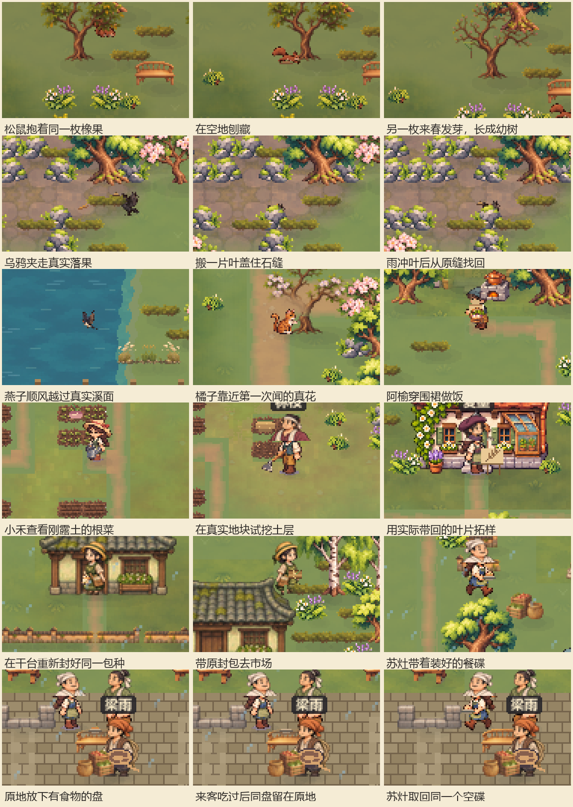

# 1.1.7：重新核对 5,000 条，接通有实际过程的行为

此前剩余 4,913 条是“未接入”，不等于“都不能实现”。本轮逐项重审 424 个基础定义及其 4,576 个条件变体，新增 **54 个基础行为、39 个精确条件变体，共 93 个旧编号**。累计 **100 个基础行为 + 80 个条件变体 = 180 个**，还剩 **4,820 个未接入**。

这些数字只统计旧目录与正式村庄的对应关系。不能与原有 RI/ME 生活事件、章节或底层任务重复相加；也不代表 180 套独立动画。

| 口径 | 1.1.6 | 1.1.7 | 本轮新增 |
|---|---:|---:|---:|
| 有真实执行流程的基础行为 | 46 | 100 | 54 |
| 同时满足附加效果与准确时空条件的变体 | 41 | 80 | 39 |
| 总计 | 87 | 180 | 93 |
| 未接入 | 4,913 | 4,820 | −93 |

## 为什么没有直接打开全部编号

旧列表中的“动作”包含很多附加条件：同一颗果实的保管、另一个指定动物在场、更多实际产量、长时间留痕或特殊天气。给名称绑定一个通用工作动画不会实现它们。

本版不仅登记已有流程，也补了缺少的有限状态和实体：同一张猫垫的携带、晾晒与归还；雨桶存量及漏水；同一包种子的防水封装；真实土层检查影响下一轮农事；同一秋果的埋藏、取回或跨冬萌芽；巢泥往返和次春使用同巢。不会因为原版缺一个字段就把整条行为判成永远不能做。

| 未接入类别（互斥，合计 4,820） | 条数 | 仍需完成的工作 |
|---|---:|---|
| 基础流程待开发 | 324 | 每项缺口列入总表，例如幼体实体、作物品种、工具保管、角色职责、实际归宿。 |
| 依赖这些未完成基础的变体 | 3,112 | 先完成同一基础链，再核对变体条件；不能单独冒领。 |
| 与现版气候矛盾 | 162 | 当前冬季降水为雪，这些已具备基础的编号却要求冬雨。 |
| 还缺指定双方实际互动 | 225 | 必须让原条目指定双方到场、互相响应并产生结果。 |
| 还缺增强效果或持久痕迹 | 700 | 额外物料、较长的真实记录或更多工作成果仍未成立。 |
| 基础已完成，附加效果或时空条件未全满足 | 297 | 包含站位/季节不符、稀有跨天气边界待证等；不一概说成不可实现。 |

分类有优先级：基础缺失先归入依赖项，所以 162 不是旧目录所有冬雨条目的总数。

[完整 5,000 行逐条表](current-behavior-audit.tsv)列出原触发、动作、结果、伙伴、时空条件、变体要求以及当前代码证据和具体缺口。[机器统计](current-behavior-counts.json)由同表生成。三个分区的 [基础能力审查](behavior-review-1.1.7/)覆盖全部 424 个定义；旧 1.1.4 的机制分类保留作历史参考，不再当作当前能力统计。

## 本轮 54 个基础行为

以下名称描述实际适配后的行为。原设计要求与当前边界在总表同时保留。例如完整房屋的建筑阶段不冒充新花槽的小工程；指定地点的小苗不冒充全图任意植物。

| 原编号 | 实际加入的流程 |
|---|---|
| A01-04 | 饮水后舔净胡须 |
| A01-06 | 吃完这一尾从池里钓来的鱼 |
| A01-07 | 在自己的垫上踩奶后休息 |
| A01-09 | 长睡醒来在门框边伸展 |
| A01-12 | 到空钩旁坐下陪着钓鱼的人 |
| A01-15 | 巡完院子沿熟悉门柱蹭一蹭 |
| A01-25 | 到刚开花的果树旁闻花 |
| A01-31 | 在畦外看同一份收菜工作 |
| A01-37 | 为拿东西的人让路后回原位 |
| A01-38 | 在门前蹭围裙边打招呼 |
| A01-50 | 被雨淋湿后到自家檐下 |
| A01-51 | 雨停后在暖灯旁抖干毛尖 |
| A01-55 | 听见轻敲窗时转耳回望 |
| A05-01 | 把同一秋果藏进地里 |
| A05-02 | 循原路找回埋藏的秋果 |
| A05-03 | 春天发现原藏果已经发芽 |
| A07-09 | 等雨停后从檐侧探头，回到原地觅食 |
| A09-01 | 到溪岸衔湿泥，为屋檐搭第一圈巢 |
| A09-08 | 春归停在去年用过的同一座燕巢 |
| A11-01 | 沿菜畦步道留下雨后湿痕 |
| A11-05 | 干燥时躲进草荫封壳，等雨后再出 |
| A13-05 | 在芦叶下等雨，雨停回原岸复飞 |
| A13-10 | 黎明停在同一片芦叶背 |
| A15-01 | 把实果塞进石缝并盖上叶子 |
| A15-02 | 雨后回到原石缝取回果子 |
| H01-07 | 用手掌压实幼树根土 |
| H01-16 | 拨土查看真实萝卜肩 |
| H01-19 | 实地用放线绳量新屋四角 |
| H01-23 | 分四段装紧花槽角 |
| H01-39 | 把湿猫垫挂起晾干后取回 |
| H01-40 | 给用过的猫垫翻面 |
| H01-49 | 换上园丁服去做田务 |
| H01-50 | 系好厨房围裙完成一炉饭 |
| H01-54 | 从田里收工后挂回雨衣 |
| H01-55 | 到实树辨花后写下第一朵苹果花 |
| H01-56 | 给施工公告牌钉上续班时间 |
| H01-57 | 在院桌写下刚进仓的收成 |
| H01-58 | 将当前受淹地块的报告改成已修复 |
| H02-01 | 挖开新畦看土质后填平 |
| H02-08 | 在果树根旁铺本树的落叶 |
| H06-01 | 给橘子端一份当日做的晚餐 |
| H06-03 | 将同一位来客的点心送到檐下 |
| H06-08 | 用托碟垫住泥地上的餐盘，饭后收回 |
| H07-04 | 到原门廊给淋湿的短札换防水包 |
| H08-02 | 取实木补好漏水的雨桶 |
| H08-03 | 对准屋檐短管给雨桶接水 |
| H09-03 | 配出暮色试色条供下一幅画使用 |
| H09-07 | 把真实果树落叶拓成一张叶脉卡 |
| H10-04 | 将返程淋湿的种袋换上防水封 |
| S04 | 进檐下躲雨后恢复同一巡路 |
| S05 | 燕子给先下行的麻雀让出落点 |
| S12 | 实际云散时停步看新天光 |
| S15 | 借同一阵顺风飞过溪桥 |
| S22 | 听见真树倒地后退到安全地段 |

## 场景与动画

图中是不同实际回放存档的局部取景：同一枚果子埋下与萌芽、乌鸦盖叶再取回、顺风飞行、围裙做饭、土层窗口、同包换封和同盘满/空/收回。不是概念图。画面复用既有像素人物与动物帧，按真实状态绘制泥、种包、绳、垫、餐盘、叶卡、土圈和手持物。没有宣称每个编号都有单独重绘动画。

新菜单接线：右键“轻敲窗户”只在真实前台命令时请求橘子响应。猫需要醒着、在本屋窗附近且有空档；先转耳、再回望，之后继续原巡路或剩余休息。不会用自动测试启动、读档或远处点击伪造这条行为。其他新增生活由正常排程触发，不依赖用户连续右键操作。

## 证据等级与边界

- 基础流程的来源、携带、目标位置、消耗及中途读档有专项覆盖。新增 54 项中，50 项取得自然回放完成，敲窗 1 项需要真实输入；花槽工程、施工续班公告和近距离落木避让 3 项通过定向因果测试，但本轮没有取得自然完成收据。不会把定向测试说成普通新档全部自动发生。
- 39 个新增变体分别使用自然/旧档升级续跑收据和定向因果证明。其中 15 个追加了完整精确条件的真实流程定向验证（14 个家庭/共享场景，以及画师池岸倒影）；施工等少数稀有变体依赖对应基础的因果测试及条件约束，本轮没有自然收据。定向测试实际走路、作业、消耗/改变状态，不直接写“已完成”计数。
- 2,000 世界日联动回放使用固定 365 真实日的建设许可夹具，验证 23 项社交主线。它不是让新用户几小时内解锁一年内容，也不是一年现实时间的内存实测。
- 修复了换围裙挤占实际来客备餐和邻居晚餐的优先级：已有真实供餐需要时直接做饭。

## 有界数据、存档与扩展

5,000 编号沿用原来的固定位图，只有最近 12 条完成记录。生态只保留三个实果槽及有限巢、纸封、手记、雨桶、土层位，不按运行天数追加历史列表。只绘制视野内可见部分；视野之外仍按世界规则推进。正式快照保持 256 KiB 上限。

升级将原 behavior revision 2 存档逐字节留为一个带摘要的备份，再写 revision 3。旧编号顺序、地图身份和已见记录不重排。关闭与重开不会再次复制同版备份。已有用户进度不用于破坏性快进测试。

开发时运行 `tools/compile_legacy_bindings.py --check` 与 `tools/audit_current_behaviors.py --check`，确认登记表、代码及逐项统计一致。新精确变体使用逐 ID 白名单，不能通过放宽多个条件生成一批未经核实的排列组合。后续开发应按总表的实际缺口补领域流程，再登记；本轮不把尚缺机制的 4,820 条说成已实现。
