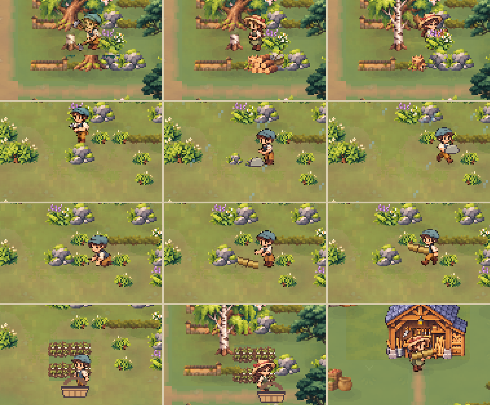
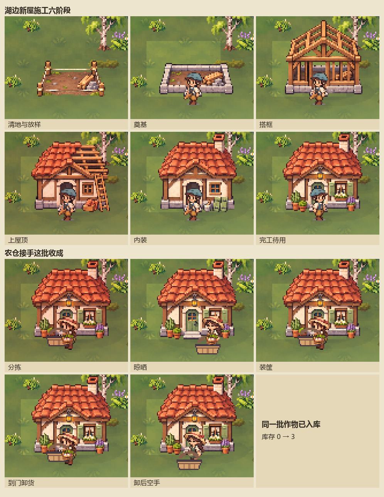

# 可作业景物的显示约定

显示读取实际任务、工具、资源阶段、脚点及货物状态。保留修订 3 的树冠避挡、原生像素比例、视口裁切和各地区景物布置。未开放地块和受保护的景物沿用原显示。

| 资源 | 处理过程 | 产物、清地和再利用 |
| --- | --- | --- |
| 树木 | 保留原树冠。角色拿斧抵达作业点后使用斧击帧，树根处出现随已完成工量增加的小缺口。 | 倒木横在原根位，保留树桩和实际待运木料。取走木料后仍可看见树桩，清根后露出原地面。搬运帧显示手里实际的木料。 |
| 岩石 | 保留原岩块。持锤敲击时使用同图集的挥击帧，岩面裂纹随已完成工量增加。 | 裂石阶段显示小碎岩和实际待运石料。收走后让出格位，石料随搬运及施工的真实货物状态显示。 |
| 草、芦苇和灌丛 | 保留原地植株。角色持锄抵达后使用除草帧，逐步减少植株。 | 草与芦苇留下伏倒的草茎和纤维束，灌丛留下可搬的小木料。纤维由实际的袋子运走或送去搓绳，收纳仍根据其真实库存。 |
| 清地后的使用 | 清理状态只改变执行中的原位置及局部画幅。临时草、原根和剩余碎料依权威状态退场。 | 真正启用的作物、工程和道路使用既有建设阶段与图像。收到材料前不会在施工处画出图案充当材料。 |

斧击、锄地和搬运复用已嵌入的人物帧。石工复用已有锤具，动作与裂石相接。倒木、碎石和草束使用现有素材配合小幅像素轮廓变化。固定景物和可作业景物共用视口索引，索引边界包含倒木及产物。角色抵达作业点后，原有树冠透视也覆盖相邻实际工作对象。清理本身只让视口内的对象重绘，真实地表变动与滚动沿用原有地表缓存。

## 正常自动回放

图像来自默认新档自动回放中首次观察到并保存的实际状态。使用原生绘制器逐个渲染，裁出工作位置后拼图。前三行依次是树木、岩石、草纤维。每行从左至右呈现拿工具作业、产物留在原地等待拾取、角色拿到货物后离开。末行的左、中两图是两块新增田的实际收获，右图是在作坊持纤维搓绳。图中搓绳处于作业阶段，成品入库以独立库存记录核验。

### 湖边新屋与农仓

两组画面取自实历 365 天存档续跑期间保存的实际状态，使用同一镜头绘制湖边地块。前两行从左到右依次是清地与放样、奠基、搭框、上屋顶、内装、完工待用。后两行显示农仓启用后，小禾分拣、晾晒和装筐，再到门口卸货。卸货前她手里是这批作物，卸完后空手。对应回放记录确认这 3 份作物在农仓门口转入库存，库存由 0 增至 3。

## 显示专项验证

显示测试覆盖倒木和散料的图像边界、实际待运数量为零时移除散料、逐工序调整画面与撤去景物，以及已清出地块使用实际四格作物。测试为直立、初次缺口、倒木、收料后树桩和清根分别设置起始状态，并在同一视口比较画素。另一个测试使用引擎准备树、石、草的作业和拾取场景，再推进真实拾取提交以核对工具、原地待运量和手持货物。这些是显示专项场景，上面的拼图取自正常自动回放。
